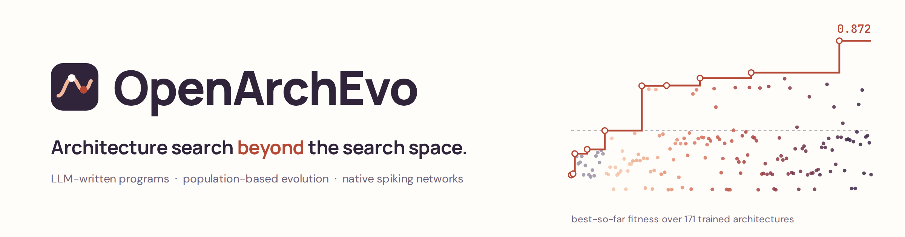
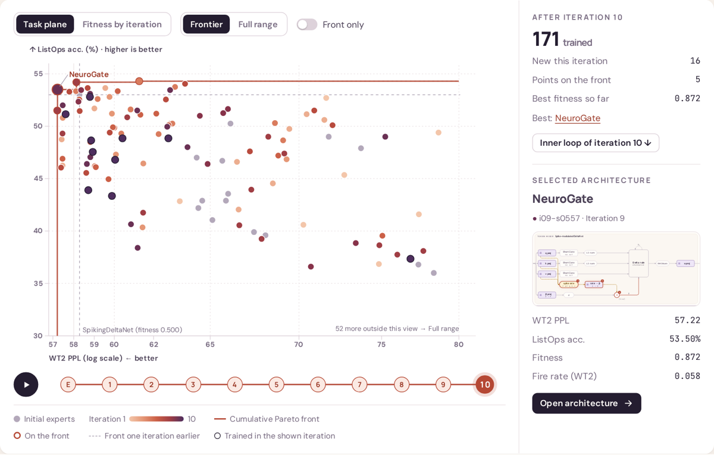
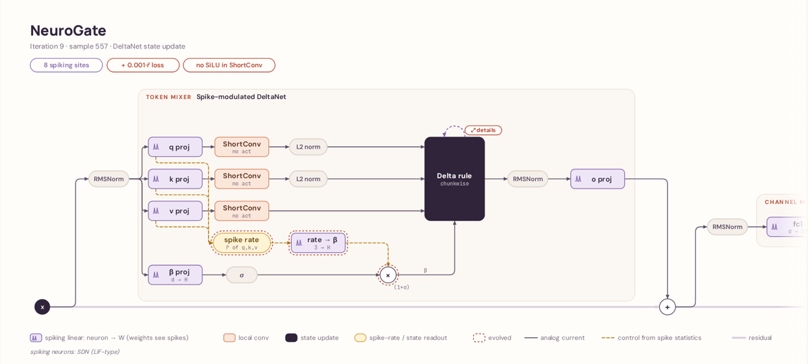
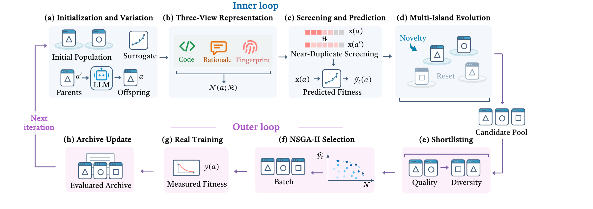
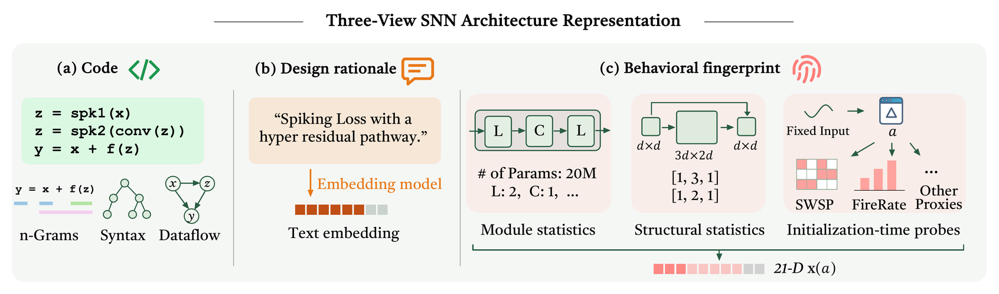

<p align="center">
  <a href="https://optima-cityu.github.io/OpenArchEvo/">
    <picture>
      <source media="(prefers-color-scheme: dark)" srcset="assets/banner-dark.png">
      
    </picture>
  </a>
</p>

<h3 align="center">An LLM writes complete architecture programs.<br>A population-based evolutionary search decides which ones survive.</h3>

<p align="center">
  <a href="https://optima-cityu.github.io/OpenArchEvo/"></a>
  <a href="https://arxiv.org/abs/2609.40258"></a>
  <a href="zoo/"></a>
  <a href="https://github.com/Optima-CityU/OpenArchEvo/actions/workflows/tests.yml"></a>
  
  <a href="LICENSE"></a>
</p>

<p align="center">
  <b>Ruoyu Zhao<sup>*</sup> · Jiaqi Wu<sup>*</sup> · Chenyu Zhu · Zhichao Lu<sup>&dagger;</sup></b><br>
  City University of Hong Kong<br>
  <sub><sup>*</sup> Equal contribution · <sup>&dagger;</sup> Corresponding author</sub>
</p>

<p align="center">
  <a href="https://optima-cityu.github.io/OpenArchEvo/"><b>Project page</b></a> ·
  <a href="https://arxiv.org/abs/2609.40258"><b>Paper</b></a> ·
  <a href="zoo/"><b>Architecture zoo</b></a> ·
  <a href="#citation"><b>Citation</b></a>
</p>

---

Most neural architecture search works inside a fixed space of cells and operators. **OpenArchEvo searches over code**: an LLM acts as the mutation operator and rewrites whole architecture programs, while a population-based evolutionary loop with islands, a surrogate and a three-view novelty measure decides what survives and what gets trained. The pipeline is problem-agnostic; in the paper we use it to discover **native spiking sequence models**.

## Highlights

- **Open program space.** Candidates are executable PyTorch blocks, so the search can invent mechanisms no predefined space contains.
- **Evolution, not a single agent.** Multi-island populations, NSGA-II selection over predicted fitness and novelty, and a TabPFN surrogate screen thousands of LLM proposals per iteration; only ≤16 are trained.
- **Three-view representation.** Code, design rationale and a behavioural fingerprint (spike-pattern and firing-rate probes plus module and structural statistics) describe every program before training.
- **Results.** 10 iterations, 151 new trained architectures, about 132 V100 GPU-days. NeuroGate reaches 26.4 WikiText-103 PPL, ahead of the ANN DeltaNet (27.5), with 31.7× lower estimated arithmetic energy than a dense Transformer.

<table>
  <tr>
    <td width="50%"><a href="https://optima-cityu.github.io/OpenArchEvo/#evolution"></a></td>
    <td width="50%"><a href="https://optima-cityu.github.io/OpenArchEvo/arch.html?arch=i09-s0557"></a></td>
  </tr>
  <tr>
    <td align="center"><sub>Replay ten iterations of the search and click any of the 171 trained architectures.</sub></td>
    <td align="center"><sub>Every architecture has a block diagram, its source code, the LLM's design rationale and metrics.</sub></td>
  </tr>
</table>

## How it works

<p align="center"></p>
<p align="center"><sub><b>Pipeline.</b> The <b>inner loop</b> (blue) evolves LLM-written programs on islands and screens them with a surrogate; the <b>outer loop</b> (purple) trains a small, selected batch and updates the archive.</sub></p>

<p align="center"></p>
<p align="center"><sub><b>Three-view representation.</b> Every program is described by its <b>code</b> (CodeBLEU), its <b>design rationale</b> (text embedding) and a <b>behavioural fingerprint</b> (21 statistics, incl. spike-pattern and firing-rate probes, measured before training). They drive novelty, duplicate screening and the surrogate.</sub></p>


1. **Inner loop.** On islands of related programs, the LLM rewrites parent programs (code + design rationale); thousands of candidates per iteration, none trained.
2. **Outer loop.** Picks a small batch (≤16) by predicted fitness and novelty, hands it off for real training, and adds the measured results to the archive.
3. **Surrogate.** TabPFN, refitted on the archive each iteration, predicts task metrics for every candidate in the inner loop.
4. **Three-view representation.** Each program is compared by its code, its rationale and a *behavioural fingerprint* (21 statistics measured once at initialisation); this drives novelty and duplicate rejection.
5. **Proxy training.** Short, fixed-protocol training runs (here WikiText-2 and ListOps) give the measured fitness.

Details: [docs/pipeline.md](docs/pipeline.md).

## Quickstart (CPU, no GPU or LLM)

```bash
git clone https://github.com/Optima-CityU/OpenArchEvo && cd OpenArchEvo
pip install -e ".[dev]"
python scripts/run_round.py --run-dir runs/demo --dry-run --auto
```

`--dry-run` replaces the LLM, surrogate and training with offline fakes and runs
three small outer iterations in seconds; inspect `runs/demo/` to see what each
stage writes. For a real search (LLM endpoint, GPU surrogate service, training
machines) follow [docs/real-run.md](docs/real-run.md).

## Use it for your own problem

* **Task:** write a training script that takes `--program` and `--result_json` and writes `{"metrics": {...}}`; add a fitness mode in [`openarchevo/fitness.py`](openarchevo/fitness.py).
* **Search space:** edit the program contract in [`openarchevo/contract.py`](openarchevo/contract.py) and the prompt templates in [`openarchevo/llm/templates/`](openarchevo/llm/templates/); seed the archive with a few hand-written programs.
* **Fingerprint:** replace the spiking-specific probes in [`openarchevo/fingerprint/`](openarchevo/fingerprint/) with ones that suit your models.
* **LLM / surrogate:** any OpenAI-compatible endpoint works from [`configs/search.yaml`](configs/search.yaml); other backends implement one small interface.
* Keep the dry run passing after every change. Guide: [docs/extending.md](docs/extending.md).

## Architecture zoo

Source code of every architecture trained in the paper's search, with metrics in [`zoo/index.csv`](zoo/index.csv). See [zoo/README.md](zoo/README.md).

| Folder | Files | Contents |
|---|---|---|
| [`zoo/experts/`](zoo/experts/) | 20 | Initial archive: spiking versions of published linear-attention / SSM families |
| [`zoo/discovered/`](zoo/discovered/) | 151 | Programs discovered and trained during the 10 search iterations, with LLM rationales |
| [`zoo/elites/`](zoo/elites/) | 3 | The three architectures analysed in the paper: NeuroGate, HomeoResSSM, LoopMem |
| [`zoo/asi_arch/`](zoo/asi_arch/) | 152 | ASI-Arch-derived programs from an earlier study (separate protocol) |

## Citation <a id="citation"></a>

```bibtex
@article{zhao2026openarchevo,
  title   = {Large Language Model-Guided Evolutionary Discovery of Native Neural Architectures for Spiking Sequence Modeling},
  author  = {Zhao, Ruoyu and Wu, Jiaqi and Zhu, Chenyu and Lu, Zhichao},
  journal = {arXiv preprint arXiv:2609.40258},
  year    = {2026},
  url     = {https://arxiv.org/abs/2609.40258}
}
```

Apache License 2.0 ([LICENSE](LICENSE));
third-party code, weights and datasets: [THIRD_PARTY_NOTICES.md](THIRD_PARTY_NOTICES.md).
No model weights or datasets are included.
