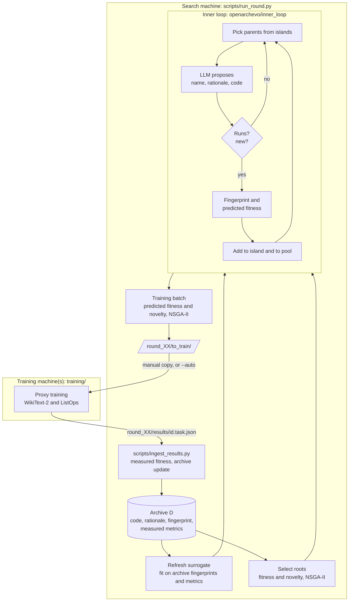

# How the pipeline fits together

OpenArchEvo searches an open program space: each candidate is a Python module
that defines one sequence block, and an LLM rewrites and recombines these
modules. Real training is expensive, so there are two nested loops:

* the **inner loop** generates many programs and screens them with a surrogate
  that predicts task performance from a behavioural fingerprint;
* the **outer loop** sends a small, diverse batch to real training each
  iteration and adds the measured results to the archive.

This page describes the flows and where each piece lives. It leaves out
implementation details that you will probably replace; the code and its
docstrings have them.



## The three views of a candidate

Every candidate (`openarchevo/candidate.py`) carries:

| View | Produced by | Used for |
|---|---|---|
| **code** | the LLM | the program itself; code similarity (CodeBLEU) |
| **design rationale** | the LLM, then an embedding model (initial archive: `--rationales`, e.g. `zoo/experts/rationales/`) | rationale similarity (cosine of embeddings) |
| **behavioural fingerprint** | the surrogate service runs the untrained program once | surrogate input; fingerprint similarity |

The **fingerprint** (`openarchevo/fingerprint/`) has 21 numbers: 7
initialisation-time probes (zero-cost proxies such as SynFlow, NASWOT and a
spike-pattern score, plus firing rate) and 14 module and structural
statistics. The feature order and fixed scaling bounds are in
`fingerprint/schema.py`; the bounds were calibrated for the default probe batch
and SDN neurons, so recalibrate them if you change either (see
[extending.md](extending.md)).

**Similarity** (`openarchevo/novelty/`) is the mean of the three view
similarities. **Novelty** of a program is its mean dissimilarity to a reference
set (the archive when choosing roots, the round's candidates when choosing the training
batch). Two programs are near-duplicates when any single view is (almost)
identical.

**Fitness** (`openarchevo/fitness.py`) maps each task metric to (0, 1) relative
to an anchor model and averages over tasks. The same mapping scores surrogate
predictions (ŷ) and measured results (y), so the two are on one scale. Per
task, the relative improvement over the anchor, `r = Δ / (anchor · T±)`, is
clipped to [-1, 1] and squashed by an asymmetric sigmoid `1 / (1 + exp(-κ± r))`,
with separate tolerance `T` and slope `κ` for gains and losses; the anchor
itself scores 0.5. In the paper the anchor is the SpikingDeltaNet expert
(WikiText-2 PPL 58.28, ListOps 53.0).

## Inner loop

`openarchevo/inner_loop/search.py`, `islands.py`. Settings: `inner_loop:` in
`configs/search.yaml`.

1. The roots are clustered into islands by three-view similarity.
2. Parents are sampled from one island, or across islands, with a preference
   for high ŷ and for programs that differ from their island-mates.
3. The prompt (`openarchevo/llm/templates/`) shows the parents with their
   rationales and code, ordered from weakest to strongest ŷ; the LLM returns a
   name, a rationale and new code. The order is the only performance
   information in the prompt: no metric values are shown.
4. A proposal is rejected if it does not parse, cannot be built and run by the
   surrogate service, or is a near-duplicate of a parent or island member.
5. Accepted programs get a fingerprint and a predicted ŷ, join the most similar
   island and enter the round's pool. Islands are trimmed when they grow too
   large, and the weaker half is periodically reset from the stronger half.

The loop stops after `pool_size` accepted programs. Each program gets the id
`r{t:02d}-s{n:04d}` (round, running number in the inner loop).

## Outer loop and the training hand-off

`openarchevo/outer_loop/round.py`, `selection.py`, `handoff.py`. Settings:
`outer_loop:` in `configs/search.yaml`.

One iteration: refresh the surrogate on the archive, select roots, run the
inner loop, drop near-duplicates of the archive, then pick at most
`batch_size` programs within the remaining `budget` by NSGA-II on ŷ and
novelty.

The selected programs are then trained for real. In the original study, search
and training ran on different machines, so each iteration was closed by hand.
The repository keeps that boundary as files:

```text
python scripts/run_round.py --run-dir runs/main        # writes round_XX/to_train/ and stops
#   train each to_train/<id>.py on every task -> round_XX/results/<id>.<task>.json
python scripts/ingest_results.py --run-dir runs/main   # adds measured metrics; updates front.jsonl
python scripts/run_round.py --run-dir runs/main        # next iteration
```

* `run_round.py` refuses to start while a batch is still waiting for results.
* `ingest_results.py` refuses a batch with missing metrics unless you pass
  `--allow-missing` (those programs are then left out of the archive and do
  not count towards `budget`).
* `run_round.py --auto` runs `outer_loop.train_commands` locally for every
  selected program, from the repository root (`{repo}` is also available as a
  placeholder), ingests, and continues until `rounds` or `budget` is used up.
  With `--dry-run`, training is faked; a dry-run directory is marked with a
  `DRY_RUN` file, and real and dry-run commands refuse each other's directories.
* `scripts/run_inner_loop.py` runs only the inner loop, for inspecting prompts
  and island behaviour.

A result file needs only `metrics`; `details` is free-form:

```json
{"id": "r03-s0335", "task": "wikitext2", "metrics": {"wikitext2_ppl": 41.7}, "details": {"test_ppl": 40.9}}
```

The metric names must match the fitness mode (`wikitext2_ppl`, `listops_acc`
for the default `composite` mode).

## Run directory

```text
runs/<name>/
  archive.jsonl           evaluated archive (one candidate per line)
  front.jsonl             archive members non-dominated in measured fitness and novelty
  similarity_cache.json   cached pairwise similarities (keyed by candidate id)
  DRY_RUN                 only in --dry-run directories
  round_XX/
    surrogate_context.json  roots.jsonl  pool.jsonl  shortlist.jsonl
    to_train/manifest.jsonl  to_train/<id>.py
    results/<id>.<task>.json
    INGESTED                marker written by ingest_results.py
```

## Surrogate service

`scripts/start_surrogate.py` serves `openarchevo/surrogate/service.py` over HTTP
(`/fit`, `/fingerprint`, `/predict`, `/evaluate`, `/status`). It runs each
program in a subprocess with a timeout, builds it inside a fixed 2-layer
wrapper and computes the fingerprint on one fixed batch, then predicts each
task metric with a TabPFN regressor fitted on the archive (perplexity in log
space). Settings: `configs/surrogate.yaml`. The search side talks to it through
`SurrogateClient` at `SURROGATE_URL`.

The service executes any code posted to it. Keep it on loopback; see the
security notes in [real-run.md](real-run.md).

## Proxy training

`training/train_wikitext2.py` and `training/train_listops.py` train one program
on one task inside the fixed wrapper `openarchevo.models.SequenceModel` (AdamW,
linear warmup, cosine decay; the block's returned regularisation loss is added
to the task loss). Settings are in `configs/training/` and match the paper's proxy-training
table:

| | WikiText-2 | ListOps |
|---|---|---|
| Layers / width / heads / FFN mult. | 6 / 256 / 8 / 4 | 2 / 128 / 4 / 2 |
| Epochs / batch | 30 / 16 | 25 / 32 |
| LR / weight decay / warmup steps | 6e-3 / 0.15 / 600 | 1e-3 / 1e-4 / 3000 |
| Data | GPT-2 BPE, 512-token blocks | 1/3 of train and val (seed 42), full test |
| Reported metric | best validation PPL | test accuracy at best validation accuracy |

The spiking setup follows SpikingSSM (Shen et al., AAAI 2025,
https://github.com/shenshuaijie/SDN): hard-reset LIF neurons whose membrane
potentials are computed by the pretrained SDN network (`neuron_type: sdn`).
`bptt` and `sltt` neurons need no checkpoint and are useful for testing.
